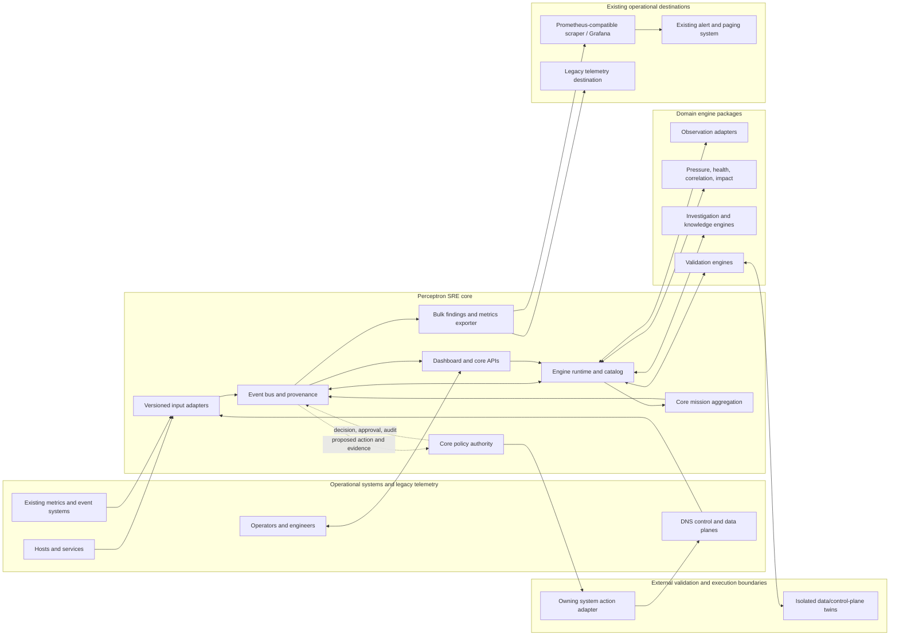

# D-01 — System Context and Trust Boundaries

**Purpose:** Show Perceptron SRE's core responsibilities and its integration boundaries. This is a logical context view, not a deployment topology.

**Interpretation:** Domain engines produce claims and evidence; core services own event transport, mission aggregation, policy authority, and operator APIs. Input/output adapters connect existing systems without making them Perceptron-owned. Paging may remain in the existing monitoring path. A dashed policy path represents a decision boundary, not an always-enabled action capability. External engine processes are not automatically sandboxed.

**Use this view when:** deciding whether a capability belongs in the core, an engine, an integration adapter, or an external system.
