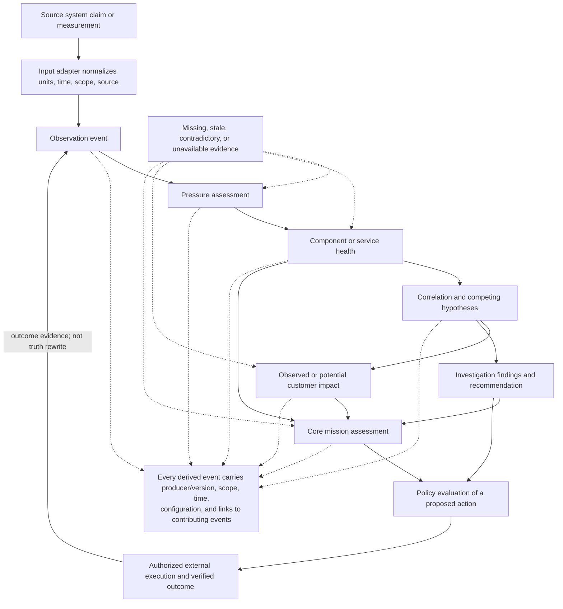

# D-02 — Reasoning Cascade and Event Lineage

**Purpose:** Illustrate the progression from observed signals to higher-level operational conclusions, while preserving uncertainty and provenance.

**Interpretation:** The cascade is conceptual and is not a mandatory fixed chain. Engines may consume events from earlier stages, while the core mission service combines relevant inputs. Missing evidence can make conclusions unknown or reduce coverage; it is never silently converted into healthy. Policy evaluates action permissibility, not factual truth.

**Layer naming:** implemented stages use `Layer-<number> <Label>`: Observation = Layer-0 Input; Pressure = Layer-1 Information; knowledge-pattern determinations = Layer-2 Determinations; health, impact and mission = Layer-3 Assessment; investigation and recommendation = Layer-4 Recommendation; Policy = Layer-5; Action = Layer-6; verified outcome = Layer-7 Outcome; knowledge updates = Layer-8 Learning. Correlation is a conceptual stage with no assigned layer yet (Open).

**Use this view when:** explaining an assessment to an operator or tracing a claim back to its evidence.
