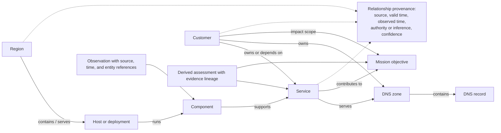

# D-03 — Entity and Impact Graph

**Purpose:** Show how source observations can be scoped to infrastructure and related to services and affected customers without claiming a single authoritative database.

**Interpretation:** This is a candidate relationship graph, not a universal schema. Edges may be authoritative, observed, or inferred and must preserve their origin and time validity. Customer/service links enable impact analysis; they do not imply that every installation stores customer identity inside Perceptron.

**Use this view when:** deciding what entity a metric refers to and how a component condition could affect a customer-level mission.
