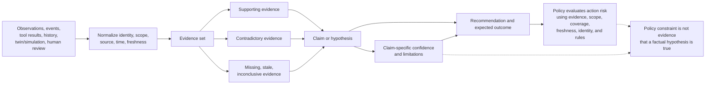

# D-04 — Evidence and Confidence Lifecycle

**Purpose:** Distinguish evidence quality and coverage from confidence in a particular claim.

**Interpretation:** Confidence belongs to a claim and its evidence domain; it is not a universal health score or authorization. Missing evidence can lower coverage or make evaluation impossible. Policy consumes confidence where appropriate but independently evaluates action risk and permissibility.

**Use this view when:** reviewing an investigation or proposed action and asking which facts support it, which contradict it, and what remains unknown.
