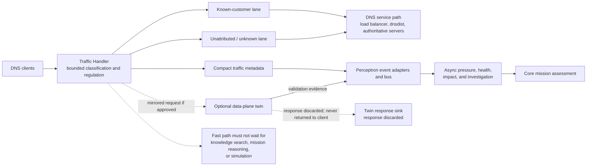

# D-05 — DNS Traffic Handler: Fast and Slow Paths

**Purpose:** Illustrate the customer-service fast path and the asynchronous analytical path for the DNS reference use case.

**Interpretation:** This functional diagram does not assign ownership or specify traffic policy. The two lanes are a candidate design; identity confidence, fairness, capacity reservations, and degraded behavior need explicit contracts. Analytics and twin work are decoupled from customer DNS responses. The twin's response is always suppressed.

**Use this view when:** evaluating NXDOMAIN storms, latency spikes, or overload while protecting customer DNS service from slow analytical processing.
