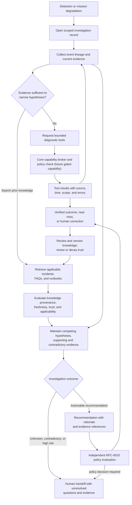

# D-06 — Investigation and Knowledge Workflow

**Purpose:** Show how a symptom can trigger an evidence-oriented investigation without prematurely declaring a root cause or executing a runbook.

**Interpretation:** Tool execution is only a proposed future capability and must be core-mediated. A knowledge item can guide the search but does not prove the current cause or authorize an action. “Unable to determine” and escalation are valid outcomes.

**Use this view when:** investigating a DNS propagation delay, database divergence, queue backlog, or host-pressure event and preserving alternatives rather than overclaiming root cause.
