# D-07 — Twin Validation and Promotion

**Purpose:** Show how data-plane and control-plane twins provide validation evidence without becoming a production authorization path.

```mermaid
flowchart LR
    Proposal["Candidate change or remediation"]
    Scope["Bind candidate to exact target,\nscope, version, and expected effects"]
    Test["Select validation plan"]
    DataTwin["Data-plane twin\nmirrored queries; responses suppressed"]
    ControlTwin["Control-plane twin\nisolated state and replay"]
    Simulation["Simulation\nmodeled scenario and assumptions"]
    Result["Validation result with coverage,\nfreshness, drift, fidelity, and provenance"]
    Review{"Validation sufficient\nfor this candidate scope?"}
    Revise["Revise proposal or gather\na more representative test"]
    Policy["Independent policy evaluation"]
    Approval["Required human approval\nwhen policy demands"]
    Execute["Owning system executes\nonly authorized change"]
    Verify["Verify production outcome\nand customer/service impact"]
    Audit["Append outcome and evidence"]

    Proposal --> Scope --> Test
    Test --> DataTwin
    Test --> ControlTwin
    Test --> Simulation
    DataTwin --> Result
    ControlTwin --> Result
    Simulation --> Result
    Result --> Review
    Review -->|"No or unable to evaluate"| Revise --> Scope
    Review -->|"Evidence accepted for policy input"| Policy
    Policy -->|"deny, hold, or require validation"| Revise
    Policy -->|"permit subject to gates"| Approval
    Approval --> Execute --> Verify --> Audit
    Verify -->|"observed outcome evidence"| Audit
```

**Interpretation:** A twin pass is evidence, not approval. A simulation is a model, not a twin. Scope and coverage constrain what validation can support. The owning control plane executes; Perceptron does not bypass it.

**Use this view when:** validating DNS zone changes, configuration rollout, or a proposed mitigation before policy review.
