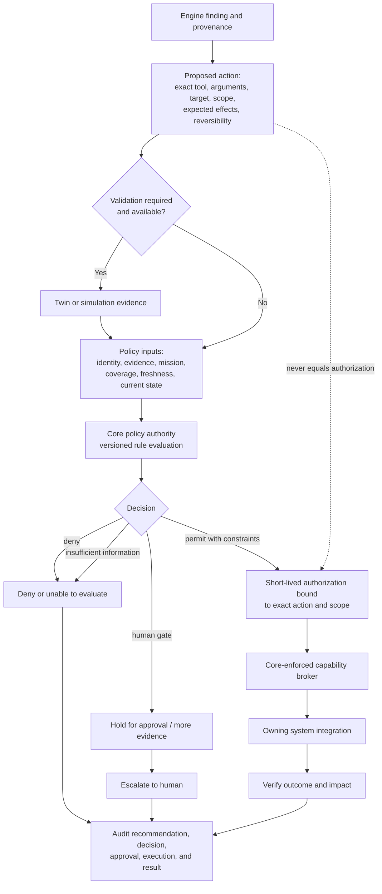

# D-08 — Policy, Authorization, and Action Lifecycle

**Purpose:** Make the safety gates explicit between an engine recommendation and a side effect.

**Interpretation:** Recommendations, validation, approval, authorization, execution, and outcome are distinct records. An authorization is specific, expires, and becomes invalid when relevant context changes. Confidence cannot bypass policy. If the broker or policy service is unavailable, no execution is permitted.

**Use this view when:** reviewing any proposed remediation or debating whether a default engine can be allowed to self-mitigate.
