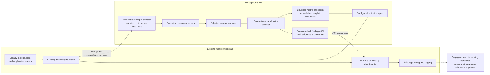

# D-09 — Legacy Telemetry Interoperability

**Purpose:** Illustrate a vendor-neutral path for consuming existing metrics and returning richer findings to the same observability destination.

**Interpretation:** A scrape endpoint is not a remote-write exporter. Detailed findings and arbitrary event payloads belong in the bulk API/event interface, not high-cardinality metric labels. Adapter failures, stale source data, privacy filtering, authentication, retries, and dropped data must be visible.

**Use this view when:** integrating Perceptron into a legacy monitoring system without replacing its metrics backend or paging routes.
