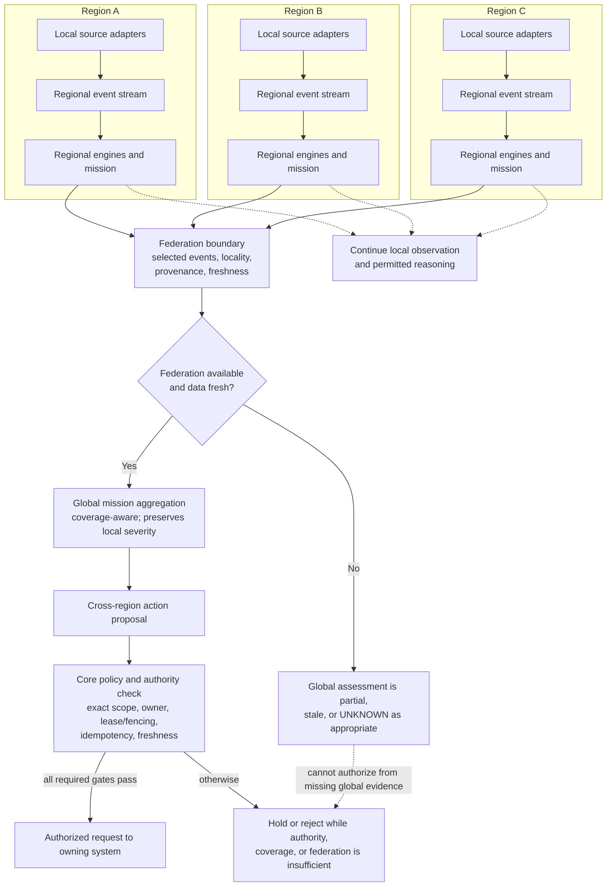

# D-10 — Regional Federation and Degraded Operation

**Purpose:** Show candidate local reasoning and selective federation while preserving gaps during a partition. This is not an approved topology.

**Interpretation:** Regions may continue local observation when disconnected, but local visibility does not imply global completeness or cross-region action authority. Missing regional inputs must reduce coverage or produce an unknown/partial result. Queue replication alone does not settle work ownership or prevent duplicate execution.

**Use this view when:** reasoning about a region outage, network partition, stale federation link, or recovery/rejoin.
