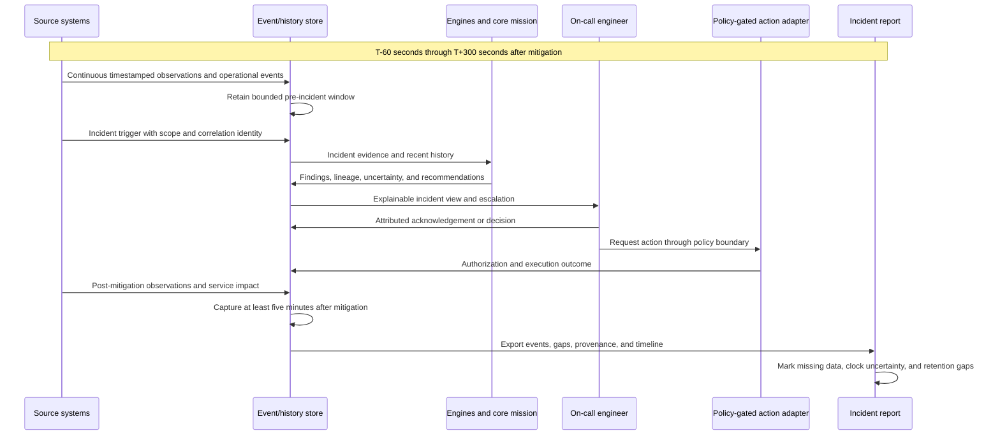

# D-11 — Incident Report Time Window

**Purpose:** Define the records needed to reconstruct the requested interval: one minute before an incident, the incident and response, and five minutes after mitigation.

**Interpretation:** The time window anchors to explicit incident and mitigation timestamps, not report generation time. The record should include observation/event time, ingestion time, source, scope, evidence lineage, recommendation, human decisions, policy result, execution, and post-action verification. If a source is unavailable or the retention window is incomplete, the report states the gap rather than interpolating a fact.

**Use this view when:** designing an incident report that allows a reviewing engineer to reconstruct what Perceptron knew before and after a mitigation.
