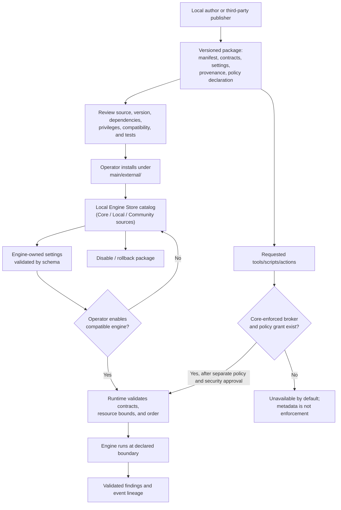

# D-12 — Engine Package, Store, and Trust Lifecycle

**Purpose:** Show how first-party and community engines enter an operator-controlled catalog, without confusing discovery, trust, enablement, and capability grants.

**Interpretation:** Bundled defaults, local packages, and third-party packages should share a common catalog contract. Remote marketplace discovery, signature verification, automatic installation, and OS sandboxing are separate capabilities and are not implied by a Store UI. Process isolation is not a security sandbox.

**Use this view when:** contributing an engine, evaluating a third-party package, or deciding whether a capability request can be enabled.
