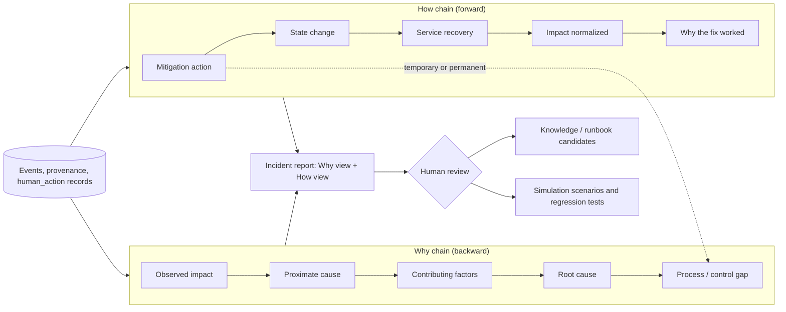

# D-13 — Why Chain and How Chain (Proposed)

**Purpose:** Show how an incident report pairs backward causal reasoning (Why) with forward remediation reasoning (How) and feeds reviewed knowledge.

**Interpretation:** Depth is evidence-driven (five is a minimum goal, not a quota). Chains may end in "unknown". Each link cites evidence and provenance; confidence appears only once a model exists (RFC-0004). Recovery is shown by post-mitigation observations (D-11), not assumed. Outputs are candidates until reviewed (RFC-0009).

**Use this view when:** designing incident reports, knowledge promotion, or dashboard Why/How views.
